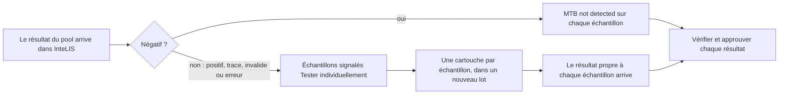

# Tester des échantillons TB groupés sur GeneXpert

Tester jusqu'à 4 échantillons de crachats sur une seule cartouche GeneXpert
MTB/RIF Ultra. Un pool négatif est enregistré comme négatif sur chacun de ses
échantillons. Pour tout autre résultat de pool, chaque échantillon du pool est
testé sur sa propre cartouche.

## Avant de commencer

- InteLIS 5.7.90 ou une version ultérieure
- Le GeneXpert relié par l'[outil d'interface](../guides/setting-up-interfacing-tool.md)
- Des échantillons [enregistrés](register-a-request.md) et reçus au
  laboratoire, non rejetés
- La permission de gérer les lots

Suivre les directives nationales sur les patients dont les échantillons peuvent
être groupés, et l'aide-mémoire national de regroupement sur la préparation
d'une cartouche groupée.

## Créer le lot groupé

1. Aller à **TUBERCULOSE → Gestion des demandes → Gérer le lot**.
2. Sélectionner **Créer un nouveau lot**.
3. Choisir le GeneXpert dans **Plateforme de test**.
4. Passer les échantillons de la série dans le lot à droite.
5. Sélectionner **Enregistrer et suivant**. L'écran **Ajouter une position de
   contrôle de lot** s'ouvre.
6. Dans **Regroupement des crachats GeneXpert**, choisir **4 échantillons par
   pool**.
7. Faire glisser les échantillons dans l'ordre de leur regroupement. Chaque
   échantillon affiche son pool, par exemple **Pool 1**.
8. Sélectionner **Save**.
9. Dans la liste **Gérer le lot**, sélectionner **PDF du lot** pour le lot.
10. Imprimer la feuille de travail. À partir de ce moment, les pools ne peuvent
    plus changer, car des cartouches peuvent être étiquetées à partir d'elle.

La feuille de travail d'un lot groupé liste une ligne par cartouche, dans
l'ordre de passage. Chaque ligne porte le code-barres à scanner comme ID
d'échantillon de la cartouche.

| ID d'échantillon de la cartouche | Colonne Échantillons | Action |
|---|---|---|
| POOL-20261020001-1 | Pool de 4, avec les 4 codes d'échantillon | Mélanger les 4 échantillons dans une seule cartouche |
| TB26-0109 | Échantillon unique | Passer l'échantillon sur sa propre cartouche |

Les codes de pool commencent toujours par **POOL-**. Les codes d'échantillon
jamais.

??? question "Si un échantillon affiche Tester individuellement sur l'écran des positions"

    L'échantillon faisait déjà partie d'un pool, ou c'est le seul échantillon
    restant à la fin. Il passe sur sa propre cartouche avec son propre code
    d'échantillon.

??? failure "Si le choix de regroupement ne peut pas être modifié"

    La feuille de travail a été imprimée, ou un pool du lot a un résultat.
    Laisser les pools tels quels. Créer un nouveau lot pour tout autre
    échantillon. Un lot dans cet état ne peut pas non plus être supprimé ni
    changer de code.

## Étiqueter et passer chaque cartouche

Préparer chaque cartouche comme le décrivent l'aide-mémoire national de
regroupement et la procédure opératoire du GeneXpert. Ensuite, pour chaque ligne
de la feuille de travail :

1. Écrire l'ID d'échantillon de la cartouche sur la cartouche.
2. À la demande de l'ID d'échantillon sur le GeneXpert, scanner le code-barres
   de la ligne sur la feuille de travail.

L'ID d'échantillon doit correspondre exactement au code-barres. En cas de
saisie, recopier chaque caractère, y compris **POOL-**.

## Agir selon le résultat du pool

L'outil d'interface envoie chaque résultat à InteLIS. InteLIS applique le
résultat d'un pool à chaque échantillon du pool.

### Si le pool est négatif

1. Ouvrir chaque échantillon dans **Saisir le résultat manuellement**.
2. Vérifier que la ligne de test indique **MTB not detected**, avec le
   commentaire **Pool POOL-20261020001-1 NOT DETECTED, pooled with** suivi des
   codes des autres échantillons.
3. [Vérifier et approuver](approve-results.md) le résultat comme pour tout autre
   échantillon.

### Si le pool est positif, trace, invalide ou en erreur

InteLIS n'enregistre aucun résultat sur les échantillons. Il les retire du lot
pour qu'ils puissent entrer dans un nouveau lot.

1. Aller à **TUBERCULOSE → Gestion des demandes → Gérer le lot**.
2. Sélectionner **Créer un nouveau lot**.
3. Passer les échantillons dans le lot. Chacun indique **Pool non négatif :
   tester individuellement**.
4. Passer chaque échantillon sur sa propre cartouche, avec son propre code
   d'échantillon.

InteLIS ne regroupe plus jamais ces échantillons.

??? failure "Si aucun échantillon d'un pool négatif n'a de résultat"

    L'enregistrement des pools négatifs est désactivé. Le paramètre est
    **Enregistrer un pool GeneXpert négatif sur chacun de ses échantillons**,
    dans le panneau **Réglages TB** de **ADMIN → Paramètres → Configuration
    générale**. Sa valeur par défaut est **Non**. Il se règle sur le STS, qui
    l'envoie à chaque laboratoire. Demander à l'administrateur du STS de le
    régler sur **Oui**, et seulement si le programme national accepte les tests
    en pool pour la validation des résultats. En attendant, saisir **MTB not
    detected** à la main sur chaque échantillon.

??? failure "Si aucun échantillon du pool n'a de résultat"

    Soit l'ID d'échantillon sur le GeneXpert n'est pas le code du pool, soit un
    échantillon du pool est rejeté ou a déjà un résultat final. Vérifier l'ID
    d'échantillon dans le rapport de test du GeneXpert. S'il est correct, tester
    chaque échantillon du pool seul.

## Confirmer que la série est terminée

- Chaque échantillon d'un pool négatif a une ligne de test **MTB not
  detected**.
- Chaque échantillon d'un pool non négatif affiche **Cet échantillon faisait
  partie du pool GeneXpert ..., qui n'était pas négatif** sur sa page de
  résultat.
- Aucune cartouche de la feuille de travail ne reste sans résultat.
