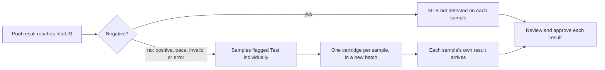

# How to test pooled TB samples on GeneXpert

Test up to 4 sputum samples on one GeneXpert MTB/RIF Ultra cartridge. A negative
pool is recorded as negative on every sample in it. Any other pool result means
each sample in the pool is tested on its own cartridge.

## Before starting

- InteLIS 5.7.90 or later
- The GeneXpert connected through the [Interface Tool](../guides/setting-up-interfacing-tool.md)
- Samples [registered](register-a-request.md) and received at the lab, not
  rejected
- Permission to manage batches

Follow your national guidelines on which patients may be pooled, and your
national pooling job aid on how to prepare a pooled cartridge.

## Create the pooled batch

1. Go to **TUBERCULOSIS → Request Management → Manage Batch**.
2. Select **Create New Batch**.
3. Choose the GeneXpert in **Testing Platform**.
4. Move the samples for the run into the batch on the right.
5. Select **Save and Next**. The **Add Batch Controls Position** screen opens.
6. In **GeneXpert sputum pooling**, choose **4 samples per pool**.
7. Drag the samples into the order they will be pooled. Each sample shows its
   pool, for example **Pool 1**.
8. Select **Save**.
9. In the **Manage Batch** list, select **Batch PDF** for the batch.
10. Print the worksheet. From now on the pools cannot change, because
    cartridges may be labelled from it.

The worksheet of a pooled batch lists one row per cartridge, in run order. Each
row has the barcode to scan as the cartridge's sample ID.

| Cartridge sample ID | Samples column | What to do |
|---|---|---|
| POOL-20261020001-1 | Pool of 4, with the 4 sample codes | Mix the 4 samples into one cartridge |
| TB26-0109 | Single sample | Run the sample on its own cartridge |

Pool codes always start with **POOL-**. Sample codes never do.

??? question "If a sample shows Test individually on the position screen"

    The sample was in a pool before, or it is the only sample left over at the
    end. It runs on its own cartridge with its own sample code.

??? failure "If the pooling choice cannot be changed"

    The worksheet was printed, or a pool in the batch has a result. Leave the
    pools as they are. Create a new batch for any further samples. A batch in
    this state also cannot be deleted or have its code changed.

## Label and run each cartridge

Prepare each cartridge as your national pooling job aid and the GeneXpert SOP
describe. Then, for each row of the worksheet:

1. Write the cartridge sample ID on the cartridge.
2. At the GeneXpert's sample ID prompt, scan the row's barcode from the
   worksheet.

The sample ID must match the barcode exactly. If it is typed, copy every
character, including **POOL-**.

## Act on the pool result

The Interface Tool sends each result to InteLIS. InteLIS applies a pool result
to every sample in the pool.

### If the pool is negative

1. Open each sample in **Enter Result Manually**.
2. Check the test row reads **MTB not detected**, with the comment **Pool
   POOL-20261020001-1 NOT DETECTED, pooled with** and the other sample codes.
3. [Review and approve](approve-results.md) the result as for any other sample.

### If the pool is positive, trace, invalid or error

InteLIS records no result on the samples. It takes them out of the batch so
they can go in a new one.

1. Go to **TUBERCULOSIS → Request Management → Manage Batch**.
2. Select **Create New Batch**.
3. Move the samples into the batch. Each one reads **Pool not negative: test
   individually**.
4. Run each sample on its own cartridge, using its own sample code.

InteLIS never pools these samples again.

??? failure "If no sample in a negative pool has a result"

    Recording negative pools is turned off. Ask the administrator of the STS to
    turn it on. Until then, enter **MTB not detected** on each sample by hand.

??? failure "If no sample in the pool has a result at all"

    Either the sample ID on the GeneXpert is not the pool code, or a sample in
    the pool is rejected or already has a final result. Check the sample ID in
    the GeneXpert test report. If it is correct, test each sample in the pool on
    its own.

## Confirm the run is complete

- Every sample of a negative pool has an **MTB not detected** test row.
- Every sample of a pool that was not negative shows **This sample was in
  GeneXpert pool ..., which was not negative** on its result page.
- No cartridge on the worksheet is left without a result.
